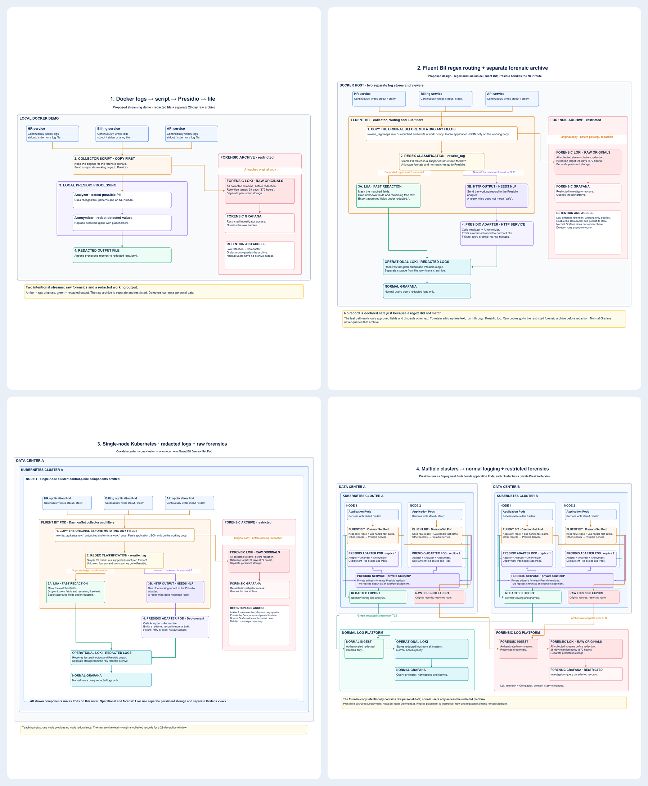

# Logging, Redaction And Four-Week Forensics

Open [all four diagrams in one draw.io file](logging-processes.drawio), or use
an individual file below. Every box, label, boundary and arrow is editable.
Use **File → Open from → Device** in draw.io / diagrams.net.

| Process | Editable diagram | Presentation image | Vector image |
| --- | --- | --- | --- |
| Docker → collector → Presidio → file, plus raw archive | [draw.io](01-docker-script-presidio.drawio) | [PNG](01-docker-script-presidio.png) | [SVG](01-docker-script-presidio.svg) |
| Fluent Bit regex/Lua routing, Presidio fallback and raw archive | [draw.io](02-docker-fluentbit-routing.drawio) | [PNG](02-docker-fluentbit-routing.png) | [SVG](02-docker-fluentbit-routing.svg) |
| One data center, one Kubernetes cluster, one node | [draw.io](03-kubernetes-single-node.drawio) | [PNG](03-kubernetes-single-node.png) | [SVG](03-kubernetes-single-node.svg) |
| Multiple nodes/clusters → operational and forensic platforms | [draw.io](04-kubernetes-multi-cluster.drawio) | [PNG](04-kubernetes-multi-cluster.png) | [SVG](04-kubernetes-multi-cluster.svg) |



## 1. What Makes An Event Eligible For Normal Storage?

There is no assumed-safe-event shortcut. Incoming records are treated as raw
until the working copy has passed the configured transformation and output
policy. A regex miss does not establish safety.

The fast path requires both a simple PII regex match and a supported structured
log format. Its Lua rules mask the matched fields and emit only approved
fields. Unknown fields and leftover free text are discarded. This is a reviewed
output policy, not a decision to trust an app-provided `safe=true` flag.

Records with no matching pattern or an unknown format go to Presidio. Its
Analyzer detects possible entities; its Anonymizer redacts detected spans.
Presidio may still miss personal data. If retaining arbitrary free text matters,
run that text through Presidio even after regex matches, rather than discarding
it on the fast path. Neither a regex match nor a detector result proves the
entire record is free of personal data.
[Presidio Analyzer](https://github.com/data-privacy-stack/presidio/blob/main/docs/analyzer/index.md),
[Presidio Anonymizer](https://github.com/data-privacy-stack/presidio/blob/main/docs/anonymizer/index.md).

## 2. Fluent Bit Makes The Routing Decision

Diagrams 2 and 3 show collection, duplication, regex routing and Lua redaction
**inside Fluent Bit**. The external Python/Presidio adapter handles only the
NLP route and its export; it does not classify all incoming events first.

```text
Application logs
  → Fluent Bit tails original records
  → Keep original copy → restricted forensic Loki
  → Process working copy:
       supported simple PII regex match → Lua redaction → operational Loki
       no match / unknown format → HTTP → Presidio adapter → operational Loki
```

The native `rewrite_tag` filter applies regular expressions to string fields
and re-emits records under new tags. Its `KEEP` option allows retaining the
original while emitting a working copy. Use non-overlapping match/tag prefixes
so re-emitted records cannot repeatedly enter the same rewrite rule.
[Fluent Bit rewrite_tag](https://docs.fluentbit.io/manual/data-pipeline/filters/rewrite-tag).

One possible tag convention is:

| Tag | Meaning | Destination or next step |
| --- | --- | --- |
| `raw.*` | Untouched original | Forensic Loki only |
| `work.*` | Working copy | Parse application payload and classify by regex |
| `fast.*` | Supported regex match; not yet redacted | Lua transformation |
| `needs_nlp.*` | No supported fast path | HTTP output to Presidio adapter |
| `redacted.*` | Successful fast-path transformation and output policy | Operational Loki |

Copy before parsing application JSON or changing fields, so malformed records
and events that fail redaction still have an original forensic path. Apply
mutating filters only to working/fast-path tags, never to the original tags.
Only successful fast-path records may receive the `redacted.*` tag. A Lua
failure must drop/retry the working record; it must not enable raw operational
export. Operational outputs must not use a wildcard that also matches `raw.*`.
[Fluent Bit Lua filter](https://docs.fluentbit.io/manual/data-pipeline/filters/lua).

The Presidio adapter receives HTTP records, calls Analyzer and Anonymizer, and
sends processed records to operational Loki. Fluent Bit's ordinary HTTP output
sends records to an endpoint; it does not automatically insert a redacted HTTP
response back into Fluent Bit's filter chain.
[Fluent Bit HTTP output](https://docs.fluentbit.io/manual/data-pipeline/outputs/http).

Diagram 1 has no Fluent Bit. Its collector script performs the original/working
copy split, sends the working copy to Presidio, and writes redacted records to
a local file. It also sends original records to the restricted forensic archive.

## 3. All Collected Originals Have A Separate Four-Week Archive

The archive is a separate **forensic Loki service**, with separate persistent
storage and restricted credentials. A separate **forensic Grafana** queries it
for investigators. Normal Grafana is connected only to operational Loki; it
has no raw-archive data source or credentials.

| Store | Content | Intended access | Retention |
| --- | --- | --- | --- |
| Operational Loki | Processed/redacted records | Normal operational users | Set independently by operational policy |
| Forensic Loki | Untouched originals from all collected streams | Restricted investigators | 28 days / four weeks / 672 hours |

Loki enforces retention; Grafana is the viewer. Set the forensic Loki retention
policy to `retention_period: 672h` and configure its Compactor, delete-request
store and persistent working directory. The supported index configuration
requires a 24-hour index period. Deletion is asynchronous after records age out;
the duration is a retention policy, not a promise of deletion at an exact second.
[Loki retention documentation](https://grafana.com/docs/loki/latest/operations/storage/retention/).

The original copy is intentional and contains the personal data removed from
the working copy. A separate container alone does not restrict readers: the
storage, access permissions and Grafana credentials must also be separate.
Use buffering, retries and delivery monitoring on both paths. Forking records
is not an atomic commit to both Loki stores and does not provide exactly-once
or lossless delivery by itself. Raw retry buffers also contain original data.

## Kubernetes Placement

Diagram 3 places the components on one node inside one cluster and one data
center. Both Loki services have separate persistent storage and separate
Grafana views. Control-plane components are omitted; the single-node teaching
layout provides no node redundancy.

Diagram 4 shows two clusters in two data centers, with two nodes each. A Fluent
Bit DaemonSet runs one collector on each eligible node. Each collector captures
an original copy and applies the working-copy routing. Presidio adapters run as
Deployment Pods on the same cluster's nodes, alongside the application Pods.
The diagram shows an example with one replica on each of two nodes. A private
`ClusterIP` Service gives collectors one address and routes requests to ready
Presidio replicas. The Service is a network endpoint, not a process outside
the nodes. Presidio's replica count is independent of the node count; the
illustrated placement is not an automatic Deployment guarantee.
[Kubernetes Deployments](https://kubernetes.io/docs/concepts/workloads/controllers/deployment/),
[Kubernetes Services](https://kubernetes.io/docs/concepts/services-networking/service/).

Fluent Bit remains a per-node collector:
[Kubernetes DaemonSet](https://kubernetes.io/docs/concepts/workloads/controllers/daemonset/),
[Fluent Bit Kubernetes collection](https://docs.fluentbit.io/manual/data-pipeline/filters/kubernetes).

Each cluster exports **two deliberately separate streams** over authenticated
TLS connections: redacted output to the central operational platform, and raw
originals to the central restricted forensic platform. This forensic requirement
means raw data intentionally leaves the source clusters on the archive route.
The normal platform never receives that raw route. The ingestion gateways
provide authentication and trusted cluster/tenant metadata; Loki itself does
not supply that authentication layer.
[Loki authentication](https://grafana.com/docs/loki/latest/operations/authentication/).

## Storage And Viewer Pair

Loki stores the logs; Grafana queries and displays them. This applies to both
the operational and forensic platforms. Each logical backend may be replicated;
multiple clusters do not require a single physical logging server.
[Grafana with Loki](https://grafana.com/docs/loki/latest/visualize/grafana/),
[Loki architecture](https://grafana.com/docs/loki/latest/get-started/architecture/).

An alternative pair is Elasticsearch for storage/search and Kibana for viewing.
[Elastic Discover](https://www.elastic.co/docs/explore-analyze/discover).

## Connection To The Existing Workshops

These files describe the intended architecture; they are not deployment
manifests or new running services. The current
[Presidio workshop](../../presidio-workshop/README.md) validates a static corpus.
The current [Fluent Bit workshop](../../log-pipeline-workshop/README.md) tails
service files and uses Lua field/message replacement before Loki. Its current
pipeline has no Presidio HTTP routing, separate forensic Loki/Grafana, or
four-week retention setup. Those are the proposed additions illustrated here.
