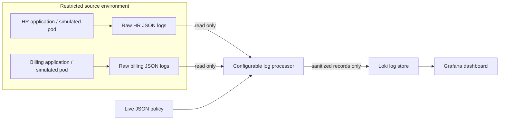

# Anonymization Before Log Ingestion

This Docker workshop simulates application pods keeping raw logs while a
configurable processor sends sanitized records to Loki. Grafana displays the
stored sanitized records. Anonymization happens before ingestion, not as a
Grafana display filter.



## Start

From the repository root:

```bash
cd log-pipeline-workshop
docker compose --profile pipeline up -d --build
```

The first build downloads the English spaCy model (approximately 401 MB) and
Grafana/Loki images. The processor reuses the Lithuanian recognizers from
`../presidio-workshop/detector.py`; keep both folders in the repository.

Open the [Log Privacy Pipeline dashboard](http://localhost:13000/d/privacy-pipeline).
Log in with username `admin` and password `workshop`. The Loki datasource and
dashboard are provisioned automatically.

| Component | Address or command |
| --- | --- |
| Grafana | `http://localhost:13000` |
| Loki API | `http://localhost:13100` |
| Processor status | `http://localhost:18088/status` |
| Raw application logs | `docker compose logs --tail 3 app-hr app-billing` |
| Processor operational logs | `docker compose logs --tail 10 log-processor` |

The first few seconds may show no logs while Loki becomes ready. Check:

```bash
docker compose --profile pipeline ps
docker compose run --rm pipeline-checks
```

The verification command waits up to 45 seconds, checks that raw PII remains
in both source volumes, and checks recent Loki records and labels for the
synthetic sensitive values. It also checks that unknown fields were dropped.

## Presenter Walkthrough

1. Show raw application logs:

```bash
docker compose logs --tail 2 app-hr
docker compose exec -T app-hr tail -n 2 /raw/app.jsonl
```

2. Show the Grafana dashboard. With the default `strict-v1` policy, names,
personal codes, email, phone, address, salary, and company profit are replaced.
The entire free-text message is replaced too, while the known event, service,
and severity remain useful. Unexpected fields such as `debug.customer.email`
and application-supplied labels never reach Loki.

3. Switch to selective free-text detection without restarting:

```bash
docker compose run --rm pipeline-config presidio
docker compose run --rm pipeline-checks
```

The processor reloads `config/active.json` on its next polling cycle. New logs
show `policy_version="presidio-v1"`, a content revision, and preserved message
structure with PII placeholders. Company profit is now dropped entirely. Old
stored records keep the policy version used when they were ingested.

4. Demonstrate invalid configuration:

```bash
docker compose run --rm pipeline-config invalid
curl -s http://localhost:18088/status
```

Within a polling cycle, `policy_valid` and `ready` become `false`. The
`forwarded` counter stops increasing, source logs continue growing, and no raw
passthrough is permitted. The supplied invalid policy deliberately asks for
`message_action="passthrough"`, which the processor rejects.

5. Recover and process the backlog:

```bash
docker compose run --rm pipeline-config strict
docker compose run --rm pipeline-checks
```

Because invalid policies do not advance checkpoints, raw records accumulated
during the pause are sanitized and forwarded after a valid policy returns.

## Configuration

Edit `config/active.json` or use the policy-switch commands above. The directory
is mounted read only in the processor; policy changes are made on the host or
through the separate configuration helper.

| Option | Allowed values | Behavior |
| --- | --- | --- |
| `version` | 1-32 lowercase letters, digits, `_`, `-` | Stored with each sanitized record |
| `message_action` | `replace`, `drop`, `presidio` | Replace all free text, remove it, or redact detected spans |
| `message_replacement` | `<REDACTED_MESSAGE>`, `<MESSAGE_REMOVED>` | Fixed placeholder for `replace` |
| `field_actions` | Known sensitive field names mapped to `replace` or `drop` | Replace a value with `<REDACTED>` or remove its field |

Sensitive fields without a configured action are dropped. Unknown top-level
and nested fields are also dropped. The output is built from an allowlist,
not by copying the raw record and removing a few known keys. Loki labels are
fixed processor metadata: workshop, namespace, and the trusted source service.
Application-supplied label values are never forwarded.
Loki also adds `service_name` and `detected_level` from the sanitized source and
severity. The live check validates those derived labels too.

The source message cannot bypass sanitization. Malformed JSON is skipped and
counted; its bytes are not printed or written into a dead-letter queue. Raw
malformed lines remain in the original source log. Loki delivery failure stops
checkpoint advancement, so the next polling cycle retries the record.

## Tests

Run unit tests for redaction, selective Presidio detection, metadata allowlists,
policy recovery, incomplete lines, retries, and durable checkpoints:

```bash
docker compose run --rm pipeline-checks python -m pytest -q
```

Run the live end-to-end check against the running stack:

```bash
docker compose run --rm pipeline-checks
```

Run the automated live policy demonstration (restores the original policy):

```bash
docker compose run --rm --entrypoint python pipeline-config demo_policy_reload.py
```

The check examines up to 1,000 entries from the last five minutes and the known
synthetic PII markers. It is a workshop acceptance check, not a proof about all
possible PII in arbitrary log text. The strict policy removes arbitrary
free-text content; selective Presidio recognition depends on covered formats
and recognizers, as demonstrated in the separate Presidio workshop.

## OpenShift Mapping

| Docker simulation | OpenShift equivalent |
| --- | --- |
| `app-hr`, `app-billing` | Application pods emitting raw stdout/stderr |
| Source volumes and Docker app logs | Restricted container/node log files accessible to pod or cluster operators |
| `log-processor` | Collector/processor operated near the source, with explicit access to raw logs |
| Mounted policy directory | ConfigMap-managed processing policy |
| Loki | Central log store receiving only processed output |
| Grafana | Viewer of centralized sanitized logs |

The application containers have no network route to Loki. Only the processor
joins both source and backend networks. Its raw-log volume mounts are read
only, and Loki/Grafana do not mount those volumes. The check helper has explicit
read-only access to raw logs to perform the demonstration; it is not a normal
viewer. Docker administrators can still inspect all containers and volumes.

This simulates the data path rather than running an OpenShift cluster or
implementing OpenShift RBAC. In OpenShift, pod stdout is normally retained in
node-managed container logs; this demo also writes an app-local file to make
the source/collector boundary easy to inspect. The collector should be the
path to the central engine: a separate raw-log shipper would bypass this
processor. Replacing data during ingestion does not erase raw source logs.

The demo persists raw volumes, checkpoints, and Loki/Grafana data across
container restarts. Delivery is at least once: a crash after ingestion but
before saving a checkpoint may replay a sanitized record. Files are append-only
in this exercise; complete rotation handling and a durable delivery queue are
outside this simulation. Processor diagnostics and checkpoint files contain
only operational metadata, not raw messages. No original-record copy is sent
to Loki as labels or structured metadata.

## Stop And Reset

Stop while retaining workshop data:

```bash
docker compose --profile pipeline down
```

Reset this workshop's raw logs, central logs, Grafana state, and checkpoints:

```bash
docker compose --profile pipeline down -v
docker compose run --rm pipeline-config strict
docker compose --profile pipeline up -d
```

The root Compose setup also includes this workshop behind the `pipeline`
profile. Use one project entry point for a running copy so its configured ports
and data volumes stay consistent.

References: [Loki ingestion and query API](https://grafana.com/docs/loki/latest/reference/loki-http-api/),
[Grafana Loki datasource provisioning](https://grafana.com/docs/grafana/latest/datasources/loki/configure/),
[Loki filesystem storage](https://grafana.com/docs/loki/latest/operations/storage/filesystem/).
