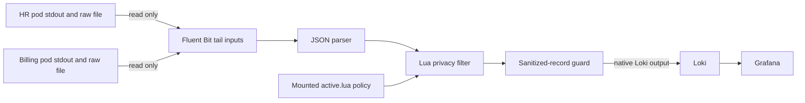

# Anonymization Before Log Ingestion With Fluent Bit

Application containers continuously write raw logs containing fictional PII.
The official Fluent Bit agent tails the files, parses JSON, applies configurable
privacy filters and sends only sanitized records to Loki. Grafana displays
what Loki actually stores; this is not a display-time privacy filter.



## Start Or Upgrade

From the repository root:

```bash
cd log-pipeline-workshop
docker compose --profile pipeline up -d --build
docker compose run --rm pipeline-checks
```

This replaces the old Python collector in the existing `log-processor` service
with `fluent/fluent-bit:5.1.4`. Raw source volumes and the existing Loki/Grafana
data remain in place. The apps/check helpers use a small Python image; this
workshop no longer downloads spaCy or imports the Presidio workshop.

Fluent Bit uses a new SQLite checkpoint volume. On first migration it reads
existing raw files from the beginning and sanitizes them again; expect a
one-time replay, not exactly-once delivery. Older stored entries remain, while
the dashboard selects new entries carrying `collector="fluent-bit"`.

Open [Grafana](http://localhost:13000/d/privacy-pipeline), username `admin`,
password `workshop`.

| Component | Address or command |
| --- | --- |
| Grafana dashboard | `http://localhost:13000/d/privacy-pipeline` |
| Loki API | `http://localhost:13100` |
| Fluent Bit health | `http://localhost:18088/api/v1/health` |
| Fluent Bit JSON metrics | `http://localhost:18088/api/v1/metrics` |
| Fluent Bit Prometheus metrics | `http://localhost:18088/api/v1/metrics/prometheus` |
| Raw stdout | `docker compose logs -f --tail 3 app-hr app-billing` |
| Collector diagnostics | `docker compose logs --tail 20 log-processor` |

The original custom `/status` endpoint is removed. Fluent Bit health reports
agent/output health, **not privacy-policy validity**. Invalid policies can drop
records while the agent remains healthy; monitor filter drops and delivery
rates and use the live checks as well.

## Presenter Walkthrough

1. Show raw PII at the source. Each app writes one entry every two seconds to
   stdout and `/raw/app.jsonl`, until stopped:

```bash
docker compose logs --tail 2 app-hr
docker compose exec -T app-hr tail -n 2 /raw/app.jsonl
```

2. Show Grafana. The default `strict-v2` policy replaces names, personal codes,
   emails, phones, addresses, salaries and profits with `<REDACTED>`, and the
   entire free-text message with `<REDACTED_MESSAGE>`. Unknown fields and nested
   debug data are absent. Labels are fixed by the collector, not by the app.

3. Switch to a compact safe summary without restarting Fluent Bit:

```bash
docker compose run --rm pipeline-config summary
docker compose run --rm pipeline-checks
```

New records carry `policy_version="summary-v1"`. Sensitive fields are dropped
entirely and the message becomes, for example, `Processed event: salary_export`.
This is a template built from an allowlisted event name, not preserved raw text.
The previous Presidio mode is intentionally removed from this workshop; use
the separate Presidio workshop for selective entity recognition.

4. Demonstrate a rejected policy:

```bash
docker compose run --rm pipeline-config invalid
curl -fsS http://localhost:18088/api/v1/metrics
```

The invalid policy asks to pass messages through unchanged. The Lua filter
rejects it and **drops incoming records**. Source logs keep growing, but the
output `proc_records` counters stop increasing once already-sanitized batches
have drained. The filter metrics expose dropped records. No raw passthrough is
permitted. A short pause before inspecting counters avoids confusing queued
safe batches with a privacy failure.

5. Recover:

```bash
docker compose run --rm pipeline-config strict
docker compose run --rm pipeline-checks
```

New records resume. Unlike the old Python processor, rejected records are
**not automatically replayed**: Fluent Bit's tail offset advances even when a
filter drops a record. Their originals remain in the source files. This
workshop prioritizes privacy over completeness during invalid policies.

## Configuration

- `fluent-bit/fluent-bit.conf`: tail inputs, SQLite checkpoints, memory limits,
  monitoring and native Loki outputs with retry settings.
- `fluent-bit/parsers.conf`: JSON parser.
- `fluent-bit/privacy-filters.conf`: remove forged guard, Lua transform,
  require success guard, remove internal guard before export.
- `fluent-bit/privacy.lua`: the Lua filter, not a custom log-shipping service.
- `config/active.lua`: mounted operator-managed privacy policy.
- `config/policies/`: strict, summary and deliberately invalid examples.

Policy example:

```lua
return {
    version = "strict-v2",
    message_action = "replace",
    field_actions = { email = "replace", salary_eur = "drop" }
}
```

| Option | Allowed values |
| --- | --- |
| `version` | 1-32 lowercase letters, digits, `_`, `-`; public policy metadata |
| `message_action` | `replace`, `drop`, `summary` |
| `field_actions` | Known sensitive fields mapped to `replace` or `drop` |

Sensitive fields without an action are dropped. All output is built from a
fresh allowlisted object; source labels, nested fields and arbitrary metadata
are never copied. Service comes from trusted input tags. Severity and event
names are allowlisted, preventing those fields from smuggling PII.

The filter reads the small policy file per record. The helper replaces it
atomically, so changes apply without restarting the collector. This is behavior
of the supplied Lua filter, **not Fluent Bit automatically reloading every
configuration file**. Changes to input/output/filter configuration require
recreating the collector:

```bash
docker compose up -d --force-recreate log-processor
```

Policies are trusted operator-controlled Lua configuration, evaluated without
global APIs and strictly validated; do not accept policy uploads from untrusted
users. Missing, invalid or malformed policies drop records. Malformed log
records are also dropped. A second native filter rejects records without a
sanitization marker, including original records retained after a Lua failure.
The source cannot forge that marker because it is removed before Lua runs.

## Tests

Execute the Lua privacy rules in Lua 5.1 (inside Docker):

```bash
docker compose run --rm pipeline-checks python -m pytest -q
```

Exercise the **actual Fluent Bit binary and full filter chain**, including
malformed input, forged markers and intentional Lua runtime errors. This host
script uses Python's standard library and invokes isolated Docker containers;
it does not mount the Docker socket in a container:

```bash
python3 verify_fluentbit.py
```

Check fresh records in the real Loki store and raw PII in both source volumes:

```bash
docker compose run --rm pipeline-checks
```

Automate policy switching, fail-closed dropping and recovery (restores the
original policy):

```bash
docker compose run --rm --entrypoint python pipeline-config demo_policy_reload.py
```

The acceptance check queries up to 1,000 fresh records, inspects labels and
allowed output fields, and checks known synthetic PII markers. It is not a
proof of anonymization for arbitrary real-world data. Run the policy demo and
live acceptance check separately, not while manually editing policies.

## Production Mapping And Limits

| Docker simulation | Production counterpart |
| --- | --- |
| App stdout plus app-local JSON files | Pod stdout retained in node-managed CRI container logs |
| Fluent Bit with read-only source volumes | Node-level collector, commonly a DaemonSet, reading container logs |
| Mounted config and Lua policy | Restricted ConfigMap or GitOps-managed collector configuration |
| Loki and Grafana | Centralized log storage and viewer |

Apps have no route to Loki. Only Fluent Bit joins both source and backend
networks; Loki/Grafana have no source-volume mounts. The acceptance-check helper
has explicit read-only raw-log access for the exercise, unlike a normal viewer.
This does not implement OpenShift RBAC; OpenShift's operator-managed Vector
collector has a different configuration surface.

Native Fluent Bit provides tailing, rotation support, SQLite offsets, batching,
retry and backpressure. This demo uses bounded **memory buffering**, not a
durable delivery queue. SQLite offsets are not acknowledgements from Loki:
abrupt crashes/restarts can lose undelivered buffered entries, and retries or
migration can duplicate delivery. Unlimited retries do not guarantee unlimited
capacity or exactly-once delivery. Tail skips oversized lines above 256 KiB.

Production must handle raw-log rotation/retention, disk limits, TLS/authentication,
restricted pod-log access, collector privileges, config validation/rollout,
monitoring and appropriate delivery durability. Filesystem buffering can improve
durability but may persist **raw pre-filter chunks**; protect/encrypt that storage
and test the complete path. Never enable raw stdout outputs, raw dead-letter
queues, or a parallel unfiltered shipper to Loki. Redaction does not erase raw
node logs or make the collector/host administrator untrusted.

## Stop And Reset

Stop this standalone workshop, retaining volumes:

```bash
docker compose --profile pipeline down
```

Destructive reset of this workshop's logs, offsets and Grafana data, only from
this folder's standalone project (not the repository-level project):

```bash
docker compose --profile pipeline down -v
docker compose run --rm pipeline-config strict
docker compose --profile pipeline up -d
```

The root Compose file includes this workshop under the `pipeline` profile.
Use one project entry point for the running stack; mixing standalone and root
projects competes for the same ports. An unused old `processor_state` volume
may remain after migration; it is not mounted by Fluent Bit.

References: [Fluent Bit Lua filters](https://docs.fluentbit.io/manual/data-pipeline/filters/lua),
[Tail input](https://docs.fluentbit.io/manual/data-pipeline/inputs/tail),
[Loki output](https://docs.fluentbit.io/manual/data-pipeline/outputs/loki),
[Monitoring](https://docs.fluentbit.io/manual/administration/monitoring).
