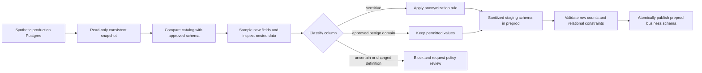

# Production-To-Preprod Refresh With Schema Drift Detection

For the reusable exercise with sorted schema files, file comparisons, a
code-defined target schema and per-column transformations, start with
[Build A Reusable Pseudonymised Database Refresh](EXERCISE.md). Its editable
[draw.io process diagram](docs/code-defined-refresh.drawio) shows the full flow.
The automatic discovery exercise below remains available separately.

This Docker workshop models a periodic refresh from a synthetic production
Postgres database into a separate preprod Postgres database. Known sensitive
fields have an explicit policy. The exercise then adds columns the original
policy does not know about and compares blind copying with a guarded refresh.



## Start

Run from the repository root:

```bash
cd schema-refresh-workshop
docker compose build refresh-runner
docker compose --profile refresh up -d refresh-prod refresh-preprod
docker compose run --rm refresh-runner python refresh.py init
docker compose run --rm refresh-runner python refresh.py refresh
docker compose run --rm refresh-runner python refresh.py verify
```

`init` resets this workshop's synthetic production and preprod schemas and
records the original schema and policies. It creates 1,000 people, 1,000
contracts, and 10 companies. Use `init --people 10000` for a larger example.
The other workshops and their databases are independent.

The runtime reuses the previous Presidio workshop's pinned dependencies and
Lithuanian recognizers. Keep the repository folders together when building.

## Presenter Walkthrough

### 1. Known Schema, Working Anonymization

The initial refresh removes names, personal codes, birth dates, salary, and
company profit. It consistently pseudonymizes email addresses, including the
foreign key from employment to people. Preprod's row counts, primary keys,
unique constraints, foreign keys, and salary CHECK constraint are validated.

### 2. Add Columns In Production

```bash
docker compose run --rm refresh-runner python refresh.py migrate new-columns
```

The migration adds:

| New column | Data | Guarded decision |
| --- | --- | --- |
| `people.emergency_contact_email` | Synthetic contact emails | Anonymize: sensitive column name and detected email values |
| `people.payload` | Sparse nested JSON containing an email and phone; populated only on the final person | Anonymize: nested sample inspection detects PII |
| `people.favorite_color` | Red, green, or blue | Keep: recognized benign field plus full-column domain validation |

### 3. Reproduce The Fixed-Policy Failure

```bash
docker compose run --rm refresh-runner python refresh.py refresh --mode legacy
docker compose run --rm refresh-runner python -m pytest exercises/legacy_validation.py -q
```

The legacy implementation always uses the original fixed field list. Unknown
fields are copied unchanged into a deliberately unsafe `legacy` schema in
preprod. The acceptance test produces **two real failures**, showing leaked
contact email and nested JSON. It is excluded from the normal passing suite.

The ordinary preprod viewer has no access to `legacy`, and this demonstration
does not replace the published guarded `business` schema. Inspect the synthetic
failure through an administrator connection:

```bash
docker compose exec -T refresh-preprod psql -U preprod_admin -d preprod -c \
  "SELECT count(*) AS leaked_contacts FROM legacy.people WHERE emergency_contact_email IS NOT NULL;"
```

### 4. Detect Drift And Make Decisions

```bash
docker compose run --rm refresh-runner python refresh.py scan
```

The report contains added column names, types, counts of sampled non-null
distinct values, detected entity counts, decisions, and reasons. It contains
no raw samples, original email addresses, or JSON values.

```bash
docker compose run --rm refresh-runner python refresh.py refresh
docker compose run --rm refresh-runner python refresh.py verify
```

The guarded refresh nulls both new sensitive fields, keeps validated color
values, and updates the approved schema inventory after validation. It also
stores the benign color domain in the policy and rechecks it on every future
refresh, so an out-of-domain value cannot silently be copied later.

### 5. Show The Uncertain Case

```bash
docker compose run --rm refresh-runner python refresh.py migrate ambiguous
docker compose run --rm refresh-runner python refresh.py refresh
```

`people.internal_memo` has an uninformative name and ordinary free text. No PII
detection does not establish safety. The refresh exits with **status 2**,
records a review decision, and leaves published preprod unchanged.

An attendee can review the field and explicitly choose a conservative rule:

```bash
docker compose run --rm refresh-runner python refresh.py approve people.internal_memo --action null
docker compose run --rm refresh-runner python refresh.py refresh
docker compose run --rm refresh-runner python refresh.py verify
```

The CLI supports `--action keep` for an explicitly reviewed field too. An
explicit keep decision is a human policy decision, not a guarantee inferred
from the absence of detector matches. Non-null sensitive fields require a
compatible reviewed transform rather than automatic nulling.

## Periodic Refresh

After initialization and the first successful refresh, start the worker:

```bash
docker compose up -d refresh-scheduler
docker compose logs -f refresh-scheduler
```

It attempts a refresh every 30 seconds and repeats the schema gate each time.
Review-required drift blocks publication, preserving the last valid preprod
version until the policy is updated. Change the scheduler's `--interval` value
in `docker-compose.yml` to alter the period. A Postgres advisory lock serializes
publication by refresh workers.

Stop only the periodic worker:

```bash
docker compose stop refresh-scheduler
```

## Database Access

| Database | Local port | User / password |
| --- | --- | --- |
| Synthetic production | 15432 | `production_admin` / `production-demo` |
| Read-only production role | 15432 | `production_reader` / `reader-demo` |
| Preprod administrator | 15433 | `preprod_admin` / `preprod-demo` |
| Published preprod viewer | 15433 | `preprod_viewer` / `viewer-demo` |

Database names are `production` and `preprod`; table names live in the
`business` schema. The viewer can read published tables but cannot read
staging tables or the intentionally unsafe legacy schema. Docker
administrators can inspect both servers and the refresh state volume.

The init/migration helpers have synthetic production administrator credentials.
Normal refreshes use the read-only production role. In a deployment, separate
the fixture/admin helpers from the read-only refresh worker.

## Detection And Publication

The gate compares PostgreSQL catalog metadata with the approved policy,
including type, nullability, default fingerprint, identity/generated flags,
and table constraints. Added fields undergo schema-name analysis and up to 100
distinct non-null samples per column. JSON samples are recursively inspected;
Presidio supplies data evidence. Sparse non-null fields are not hidden behind
a head-of-table sample consisting entirely of NULL rows.

Automatic sensitivity decisions sanitize the **whole column**, not just values
that happened to match in the sample. Unknown or ambiguous fields require
review. An automatic keep decision is limited to the demonstrated color field
and an approved enum whose entire current domain has been checked. Other
business domains can be added as explicit policy logic.

Changed definitions, removed columns, changed constraints, and new tables
block publication. New-table/constraint policy onboarding is intentionally a
reviewed extension, not implemented by the column-only approval CLI. The
workshop clone supports the types used here: text, integer, bigint, date,
boolean, jsonb, and numeric. Source defaults, sequences/identity/generated
columns, custom types, and cross-schema foreign keys fail closed rather than
being copied without an explicit implementation. Comments, defaults, functions,
and other schema objects that might embed sensitive literals are not copied.

The source is read through a repeatable-read read-only transaction, with
access-share locks on existing source tables. Rows are transformed in memory
before COPY to restricted staging tables: a raw production dump is never
restored into preprod. Constraint validation and schema replacement are one
target transaction. A failed transformation or constraint check rolls back
the stage and preserves the previously published tables.

Consistent HMAC email tokens preserve PII-based joins. The generated key lives
only in the refresh state volume, outside preprod. This is **pseudonymization**,
not a proof of irreversible anonymity: surrogate IDs and explicitly kept
business fields may still allow linkage. Sampling also cannot prove that all
possible sensitive values have been found. The workshop demonstrates governance
for new columns and conservative publication gates, not complete privacy
protection for every database shape or inference attack.

## Verification

Run the regular passing tests:

```bash
docker compose run --rm refresh-runner python -m pytest -q
```

Run the complete live walkthrough, which resets only this workshop's synthetic
schemas and leaves a working guarded preprod snapshot:

```bash
docker compose stop refresh-scheduler
docker compose run --rm refresh-runner python walkthrough.py
```

This checks baseline copying, legacy leakage, classification of all three new
columns, benign-domain drift, review blocking, email joins, and rollback when
an incompatible salary transform violates a CHECK constraint. It also verifies
that the ordinary viewer cannot access legacy data.

Retrieve the last discovery report or approved policy:

```bash
docker compose run --rm refresh-runner python refresh.py report
docker compose run --rm refresh-runner python -c "from refresh import load_policy; import json; print(json.dumps(load_policy(), indent=2))"
```

Stop this workshop without deleting its volumes:

```bash
docker compose --profile refresh --profile refresh-scheduled down
```

The root Compose setup includes this workshop behind the `refresh`,
`refresh-tools`, and `refresh-scheduled` profiles. Choose one project entry
point for a running instance so ports and volumes remain consistent.

References: [PostgreSQL transaction isolation](https://www.postgresql.org/docs/16/transaction-iso.html),
[Psycopg COPY](https://www.psycopg.org/psycopg3/docs/basic/copy),
[safe SQL composition](https://www.psycopg.org/psycopg3/docs/api/sql.html).
